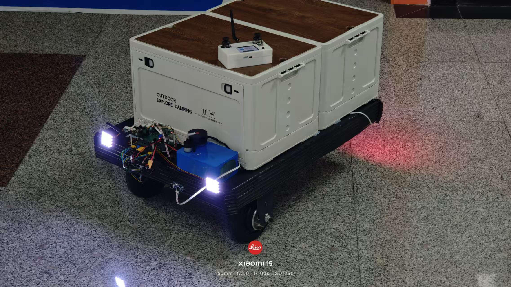
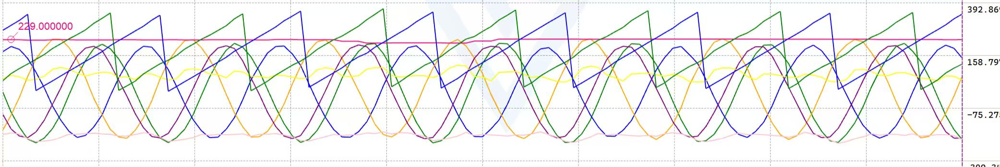
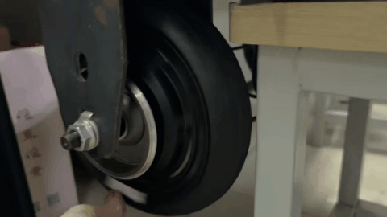
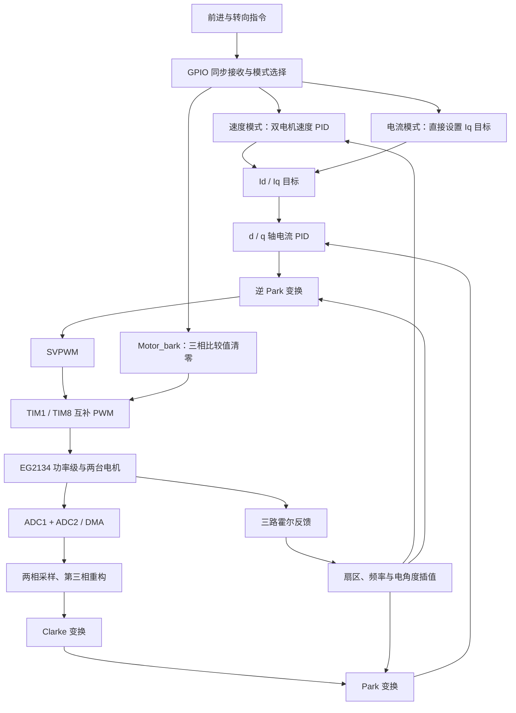

# FOC_EG2134：双电机霍尔 FOC 驱动

作者：张荣。

本项目面向校园送货小车的双轮驱动，使用 **STM32F405RGTx + EG2134 三相驱动电路**，通过霍尔反馈、两相电流采样、FOC 电流环和速度外环控制两台三相无刷轮毂电机。前进、转向指令被混合为两路目标值，用于差速运动。

当前仓库已包含双电机闭环控制主链路和历史演示素材，处于原型调试与工程完善阶段。速度环已经接入代码；无感控制仍只有框架。通信超时、初始化时序、霍尔测速边界和保护机制尚需完善，不能把现有演示等同于当前版本已经通过整车可靠性验证。

本文依据当前工作区源码和配置整理，核对日期为 **2026-10-20**。详细问题、源码依据和验收建议见 [项目结构与待完成分析](资源/项目结构与待完成分析.md)。

## 1. 应用背景与演示

小车需要承载货物，并应对校园中的坡道、减速带及转向需求。因此，驱动部分需要兼顾低速力矩、负载变化时的电流控制和左右轮速度调节。本仓库主要实现电机驱动固件，不包含整车导航、路径规划或完整的上位控制器工程。



### 驱动波形



原有记录将这张图描述为开环驱动、施加阻力时的观测结果，涉及输出矢量角度、霍尔脉冲周期、转子电角度及电流变换量。图片缺少完整的通道图例、时间单位和测试条件，因此保留为历史调试展示，不据此给出带宽、精度或响应时间指标。代码中的位置反馈来自三路霍尔信号，虽然引脚命名包含 `ENC`，实际没有使用定时器正交编码器模式。

### 电流闭环演示



原有说明记录了施加阻力、松手后电机恢复转动的现象，可用于展示电流环调试过程。素材没有同步记录电流单位、转矩、负载和固件版本，暂不作为定量性能结论。

## 2. 项目结构

```text
FOC_EG2134/
├── Core/
│   ├── Inc/                     引脚、外设句柄和 HAL 配置
│   ├── Src/                     主程序、时钟、ADC/DMA、TIM、GPIO、UART、中断
│   └── Startup/                 STM32F405 启动代码与中断向量表
├── DriveLayer/
│   ├── Inc/                     电机、驱动器、霍尔、通信与缓冲区接口
│   └── Src/
│       ├── Motor.c              双电机对象、FOC 电流环、速度环及回调调度
│       ├── PWM_EG2134.c          TIM1/TIM8 三相互补 PWM 启动与比较值更新
│       ├── Hall_Sensor.c         霍尔解码、方向判断、频率估计和停转检测
│       ├── DataReception.c       GPIO 同步接收、运动指令混合与超时检查
│       ├── UART2.c               调试串口封装，实际使用 UART4
│       ├── RingBuffer.c          字节环形缓冲区
│       └── angle_progress.c      无感观测器辅助函数，尚未接入控制
├── MiddleLayer/
│   ├── Inc/                     控制算法接口
│   ├── Src/
│   │   ├── clark_transformation.c  Clarke 正/逆变换
│   │   ├── park_transformation.c   Park 正/逆变换
│   │   ├── PID.c                  增量式 PID 与输出限幅
│   │   └── svpwm.c                空间矢量调制与开环测试入口
│   └── 电流波形.txt              历史采样文本，缺少表头且末行不完整
├── Drivers/                     ST HAL、CMSIS 和芯片头文件
├── ODrive原理图和照片/           单排 MOS 板资料、官方版参考图、板卡图片
├── PID参数表/                   PID参数.xlsx，目前为空表
├── 资源/                        项目演示图片、GIF 和详细分析文档
├── Debug/、Release/             自动生成的构建文件及历史编译产物
├── FOC_EG2134.ioc               STM32CubeMX 外设配置
├── .project、.cproject          STM32CubeIDE 工程与构建配置
├── .mxproject、.settings/       代码生成及 IDE 元数据
├── FOC_EG2134 Debug.launch      调试启动配置
├── STM32F405RGTX_FLASH.ld       Flash 链接脚本，工程当前使用
├── STM32F405RGTX_RAM.ld         RAM 链接脚本
└── README.md                    项目介绍与阅读入口
```

`Drivers/` 提供底层库支持，主要控制逻辑位于 `DriveLayer/` 和 `MiddleLayer/`。工作区中的 `.claude/` 为本地工具配置，不参与固件运行。已有 `Debug/Release` 文件用于了解构建历史，不能代替当前源码的重新构建。

## 3. 控制结构与运行流程



1. `main()` 初始化系统时钟、外设、串口和电机对象，主循环持续发送四路电流调试数据。
2. TIM1 更新中断在向下计数条件下以 `SWSTART` 发起 ADC 规则组转换。当前使用软件启动，没有配置 ADC 外部硬件触发。
3. ADC1/ADC2 同步采集一台电机的 B、C 两相，再采集另一台电机。DMA 的两个 32 位数据分别打包一组 ADC1/ADC2 结果。
4. `HAL_ADC_ConvCpltCallback()` 解包、修正偏置与增益，以 `Ia = -Ib - Ic` 重构第三相，依次执行 M0、M1 的电流环。
5. 霍尔双边沿中断更新扇区、方向和周期，电流环按扇区内经过时间插值电角度。
6. TIM10 执行速度外环，将速度误差转换为 Iq 目标；TIM6 检查停转和通信超时；TIM7 提供高分辨率软件计时。

两个电机各有独立 PID 和霍尔对象，但 Clarke、Park、SVPWM 使用全局工作区，由电流回调顺序复用。以后若调整中断优先级或并行调用算法，需要重新检查重入问题。

## 4. 硬件与外设

配置依据：[引脚定义](Core/Inc/main.h)、[定时器](Core/Src/tim.c)、[ADC](Core/Src/adc.c)、[GPIO](Core/Src/gpio.c)、[串口](Core/Src/usart.c) 和 [CubeMX 工程](FOC_EG2134.ioc)。

| 部分 | 当前配置与作用 |
| --- | --- |
| MCU | STM32F405RGTx，Cortex-M4，工程启用单精度硬件浮点 |
| 时钟 | 8 MHz HSE，系统时钟 168 MHz；APB1 定时器 84 MHz、APB2 定时器 168 MHz |
| M0 PWM | TIM1 CH1/2/3：PA8/PA9/PA10；互补输出 PB13/PB14/PB15 |
| M1 PWM | TIM8 CH1/2/3：PC6/PC7/PC8；互补输出 PA7/PB0/PB1 |
| M0 电流 | PC0 / ADC1 CH10 为 B 相；PC1 / ADC2 CH11 为 C 相 |
| M1 电流 | PC2 / ADC1 CH12 为 C 相；PC3 / ADC2 CH13 为 B 相 |
| M0 霍尔 | PB4、PB5、PC9，双边沿 EXTI |
| M1 霍尔 | PB6、PB7、PC15，双边沿 EXTI |
| 控制接收 | PA15 为 CS，PC10 为 CLK，PC11/PC12 为两路数据输入 |
| 调试串口 | UART4，PA0 TX / PA1 RX，115200、8N1；封装名仍保留 `UART2` |
| LED / 调试 | PD2；SWD 使用 PA13/PA14 |

| 定时器 | PSC / ARR | 配置推算的频率 | 用途 |
| --- | --- | --- | --- |
| TIM1、TIM8 | 5 / 1679 | 中心对齐 PWM 约 8.34 kHz | 两台电机的三相互补输出 |
| TIM6 | 83 / 999 | 1 kHz | 霍尔停转及通信超时检查 |
| TIM7 | 41 / 99 | 20 kHz，50 μs/tick | 霍尔周期与角度插值计时 |
| TIM10 | 83 / 2499 | 800 Hz，1.25 ms/次 | 双电机速度外环 |

以上为配置推算值，尚无本次实测时序。电流环设计上每个 PWM 周期执行一次，实际周期、抖动和双电机计算耗时仍需测量。TIM1/TIM8 配置了主从触发关系与 `DeadTime = 30`，该数值是死区寄存器设置，不是 30 μs；Break 输入当前关闭。

仓库中的[单排 MOS 原理图](ODrive原理图和照片/ODrive原理图_单排MOS.pdf)标注 EG2134，另附的[官方版参考图](ODrive原理图和照片/ODrive_v3.6原理图官方版.pdf)使用 DRV8301。两者应按不同硬件资料阅读，接线和器件参数需与实际板卡对应。

## 5. 当前功能与接口

| 功能 | 当前状态 |
| --- | --- |
| 双电机互补 PWM | 已接入 TIM1/TIM8，提供比较值更新与正弦波测试函数 |
| 电流采样与重构 | 已接入双 ADC + 循环 DMA，支持四路采样偏置/增益修正 |
| FOC 电流环 | 已接入 Clarke、Park、d/q PID、逆 Park、SVPWM |
| 霍尔位置与速度估计 | 已接入，扇区判断、计时和低速边界仍需修正 |
| 速度外环 | 已接入 800 Hz 调度，包含经验补偿，物理单位和最终限幅待完善 |
| 差速指令 | 已实现前进/转向混合，以及速度、电流、制动状态选择 |
| 通信失联处理 | 有 500 ms 检查代码，但接收路径未更新计时字段，当前逻辑不完整 |
| 串口调试 | 四路电流发送可见；接收重启函数尚未接到 HAL 接收完成回调 |
| 无感控制 | 只有 SMO 参数/状态结构和辅助函数，无完整观测器或模式切换 |
| 系统保护 | 未见完整的过流、母线电压、温度、驱动故障处理及恢复状态机 |

### 指令接收方式

接收逻辑见 [DataReception.c](DriveLayer/Src/DataReception.c)。引脚虽然名为 `SPI_*`，当前是 **GPIO + EXTI 实现的自定义同步接口**：CLK 上升沿同时采样两路输入，分别拼接 32 位状态字和 32 位摇杆字，从最高位开始接收。CS 为高时，需要再出现 CLK 上升沿，回调才解析并提交数据。

摇杆字高 16 位为有符号前进值 `F`，低 16 位为有符号转向值 `T`。状态字只使用低三位，当前执行规则如下：

| 状态字低三位 | 模式 | 目标值 |
| --- | --- | --- |
| `0x0001` | 速度闭环 `Motor_speedlose` | M0：`-(F/3 + T/28)`；M1：`F/3 - T/28` |
| `0x0002` | 电流闭环 `Motor_currentlose` | M0 Iq：`-(F+T)`；M1 Iq：`F-T`，接收路径限幅到 ±260 |
| `0x0004` | `Motor_bark` | 电流回调将三相比较值设为 0 |
| 其他值 | 无更新 | 保留此前状态，没有默认停机分支 |

速度混合中的除法按整数运算执行。接口还没有位数校验、校验和、完整异常帧处理和有效帧时间更新，发送端工程也不在本仓库。`Motor_bark` 的实现不等于关闭全部 PWM 通道，实际制动或桥臂状态需要结合硬件确认。

### 控制量与参数

当前“电流”是去偏置、乘增益后的 ADC 数值，电压输出是调制用的数值尺度，尚未统一标定为 A、V。速度反馈使用 `2000 / Δtick` 及滑动均值，不应直接当作机械 rpm 或转/秒。

| 控制器 | Kp | Ki | Kd | PID 内部输出限幅 |
| --- | --- | --- | --- | --- |
| M0/M1 的 Id、Iq 电流环 | 1.1 | 0.05 | 0 | ±300 |
| M0/M1 的速度环 | 2.5 | 0.055 | 0.05 | ±260 |

参数来源是 [Motor_Init()](DriveLayer/Src/Motor.c)，不是 Excel 参数表。速度环在 PID 限幅后又叠加 `目标值 × 0.8 ± 50` 的经验补偿，因此最终 Iq 目标可能超过 ±260。PID 实际实现为增量式，采样周期隐含在 Ki/Kd 中，文件头关于位置式 PID、微分滤波等描述与函数实现不符。

## 6. 工程打开与验证

仓库提供 STM32CubeIDE 工程。`.ioc` 记录 STM32CubeMX 6.16.1、STM32Cube FW_F4 V1.28.3，已有 Makefile 标注 GNU Tools for STM32 14.3.rel1。具体 STM32CubeIDE 版本未在文档中固定。

1. 在 STM32CubeIDE 中通过现有工程导入仓库根目录，确认目标芯片为 STM32F405RGTx。
2. 检查 `.ioc` 与当前 `Core/` 用户代码块，确认 TIM7、TIM10、自定义接收引脚和 UART4 配置。
3. 重新生成或刷新 IDE 构建文件，再执行 Clean / Build。现有 Debug 文件仍引用已不存在的 `angle_get.c`，Makefile 还包含本机绝对路径，不适合作为跨机器构建入口直接照搬。
4. 使用 Flash 链接脚本与重新构建的 ELF 调试；需要 HEX/BIN 时在构建配置中开启相应输出。已有 Release HEX/BIN 的源码对应关系尚未建立。
5. 上板验证前先处理下节的 P0 项，再按电流采样、霍尔方向、电流环、速度环和异常恢复的顺序验证。

本次使用 Arm GNU Toolchain 15.2.Rel1，对 `Core/Src`、`DriveLayer/Src`、`MiddleLayer/Src` 共 22 个 C 文件执行了 `-fsyntax-only -Wall -Wextra` 检查：无语法错误，发现霍尔监测中的未使用变量、SVPWM 中未定义的静态函数声明两项警告。未执行完整链接、烧录或硬件性能测试。

## 7. 待完成工作

| 优先级 | 工作内容 | 完成标志 |
| --- | --- | --- |
| P0 | 调整对象初始化、PWM 和中断启动顺序 | 初始化完成前的霍尔/定时器事件不会访问空指针或提前运行控制环 |
| P0 | 修复有效帧计时、帧长边界、失联处理 | 正常连续指令不被误判超时，短帧/超长帧被丢弃，失联按规定进入受控状态 |
| P0 | 明确停机与故障保护 | 区分制动、撤销驱动和故障锁存，验证过流等保护及恢复条件 |
| P1 | 修正霍尔扇区、计时和低速算法 | 正反转全部合法跳变、停转、噪声和计时回绕均有验证记录 |
| P1 | 完善物理量标定与控制限幅 | 电流/速度单位明确，补偿后的 Iq 仍受限，模式切换无历史状态突跳 |
| P1 | 验证采样时刻和实时性 | 记录 PWM、ADC、双电流环和速度环的周期、耗时与抖动 |
| P1 | 完成串口接收与构建复现 | 接收回调贯通，通信错误可恢复，干净检出可构建 Debug/Release |
| P2 | 补充参数表、测试数据和工程规范 | PID 表有实际记录，波形有表头/单位/版本，算法有自动化回归 |
| P2 | 实现无感观测器等扩展功能 | 完成模型、观测、启动及切换验证后，再标记为支持无感 FOC |

更多细节见 [项目结构与待完成分析](资源/项目结构与待完成分析.md)，其中列出了每项问题的源码依据、影响和验收建议。
